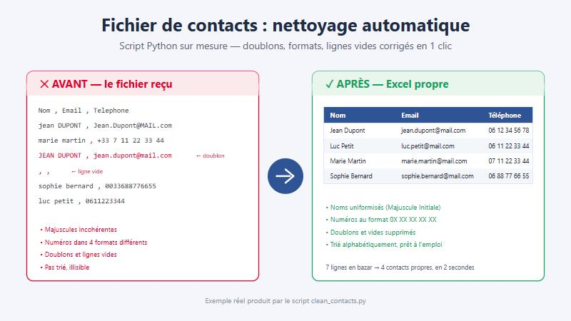

# clean_contacts.py — Nettoyage automatique de fichiers de contacts

Petit script Python qui transforme un fichier de contacts **en bazar** (doublons,
majuscules incohérentes, numéros de téléphone dans tous les formats, lignes vides)
en un **fichier Excel propre** : trié, dédoublonné, uniformisé et formaté.

## Avant / Après



Exemple réel : **7 lignes en bazar → 4 contacts propres**, en 2 secondes.

## Ce que fait le script

- Nettoie les espaces superflus et met les noms en *Majuscule Initiale*
- Met les emails en minuscules
- Uniformise les numéros français au format `0X XX XX XX XX` (gère `+33`, `0033`, `06.12...`, etc.)
- Supprime les lignes vides
- Supprime les doublons (même email)
- Trie par nom
- Exporte un `.xlsx` formaté (entête colorée, colonnes ajustées, entête figée)

## Utilisation

```bash
# Démo : génère un exemple en bazar puis le nettoie
python clean_contacts.py

# Nettoyer votre propre fichier
python clean_contacts.py contacts.csv
python clean_contacts.py contacts.csv sortie.xlsx

# Lancer les tests internes
python clean_contacts.py --selfcheck
```

## Dépendances

```bash
pip install openpyxl
```

Python 3.10+. Aucune autre dépendance (lecture CSV via la bibliothèque standard).

## Fichiers

| Fichier | Rôle |
|---|---|
| `clean_contacts.py` | Le script |
| `exemple_sale.csv` | Exemple d'entrée volontairement en bazar |
| `exemple_propre.xlsx` | Sortie nettoyée (générée par la démo) |
| `avant_apres.svg` / `.jpg` | Visuel avant/après |

---

*Besoin d'automatiser une tâche répétitive ? Ce genre de script se fait sur mesure.*
